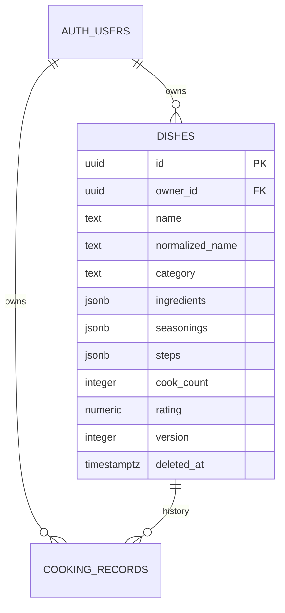

# Supabase 实时数据库接入

核实日期：2026-10-31。当前交付是可配置的云端接入，尚无真实 Supabase 项目。

## 1. 创建个人项目

1. 在 Supabase 注册 / 登录，创建项目并选择适合实际访问地的区域。
2. 保存数据库密码到自己的密码管理器；网页不需要这个密码。
3. 在 Dashboard 的 SQL Editor 新建查询，执行整个 [`supabase/schema.sql`](../supabase/schema.sql)。
4. 确认 `public.dishes`、`public.cooking_records`、`public.record_cook` 创建完成。SQL 重复执行不会删除数据。

## 2. 配置自己的登录身份

1. 在 Authentication → Users 添加 / 邀请自己的邮箱。
2. 在 Authentication → URL Configuration 中，把 Site URL 设为 `https://user-balance.github.io/diancai/`。
3. 在 Redirect URLs 明确加入 `https://user-balance.github.io/diancai/`；需要本地测试时，再加对应的本地开发地址。
4. 本应用发送登录邮件时使用 `shouldCreateUser: false`，不会自动为公众注册新用户。作为个人应用，建议在 Supabase 同时关闭 `Allow new users to sign up`，在服务端限制公众注册。
5. 若默认邮件发送受限，按 Supabase 的提示配置自己的 SMTP；邮件限额、免费项目暂停和套餐范围以 Dashboard 为准。

## 3. 在点菜本里连接

1. 在 Supabase 项目 Connect / API 配置中找到项目 URL 与 publishable key（旧项目可用 anon key）。
2. 打开点菜本 → 数据与设置，填入这两个公开配置，保存。
3. 填自己的已注册邮箱，发送登录邮件；打开邮件里的链接回到点菜本。
4. 登录后首次云端菜谱可以为空。点击「将本地菜谱导入云端」，把此设备上的入门菜谱和个人菜谱追加导入。
5. 看右上角是否显示「实时同步已连接」。

无需把 publishable key 写进源码；每台设备在界面设置一次。公开 key 不是数据库管理权限，真正的保护是 Auth + RLS。不要提供 service_role / secret key。本应用会拒绝把这些管理员密钥保存在浏览器配置里。

## 4. 接入后必须做的验收

| 验收 | 预期 |
| --- | --- |
| 新增菜谱 | Dashboard 表内出现当前用户的记录，刷新后保留 |
| 编辑、评分、记录做过一次 | 数据库对应字段变化；历史记录同步追加 |
| 同一用户两台设备 | A 更新，B 实时看到变化 |
| 两端同时记一次下厨 | 总次数增长 2，新增两条历史；RPC 行锁避免丢增量 |
| 两端编辑同一道菜 | 过期版本保存被拦截，要求重开编辑 |
| 重名，包括空格和全角差异 | UI 拦截，直接数据库写入也受唯一索引约束 |
| 另一注册用户 | 看不到前一个用户的菜谱，也不能通过 API 编辑 |
| 未登录 | 不能通过公开 key 读写私有菜谱 |
| 归档、恢复 | 归档后从主菜单隐藏，可以在归档菜单恢复 |

打开两个页面不等于验证权限。请至少分别用同一用户、多一个测试用户和未登录状态检查。云端接入失败时会显示错误，保留刷新入口。

## 数据库结构

制作次数可手工初始化，因此它不必等于历史条数。软归档采用 UPDATE，方便恢复，也让 Realtime 按用户权限处理更新事件。

## 官方资料

- [Supabase Auth](https://supabase.com/docs/guides/auth)
- [邮箱无密码登录](https://supabase.com/docs/guides/auth/auth-email-passwordless)
- [RLS](https://supabase.com/docs/guides/database/postgres/row-level-security)
- [Postgres Changes](https://supabase.com/docs/guides/realtime/postgres-changes)
- [API key 类型](https://supabase.com/docs/guides/api/api-keys)
