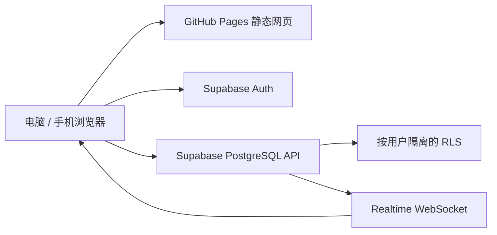

# GitHub Pages：托管网页，外接数据库

核实日期：2026-10-31。

GitHub Pages 是静态网站托管，提供 HTML、CSS、JavaScript 和静态资源发布。它不提供可运行的服务器程序，也不能在 Pages 上部署 PostgreSQL / MySQL，或把 SQLite 文件挂成可写的服务数据库。仓库中的 JSON / SQLite 文件可以供下载或读取，但网页无法把修改持久化回静态文件。

本应用采用如下结构：



用 GitHub token 从浏览器写仓库，会把代码仓库权限暴露给访问者；这不是个人菜谱数据库的合理接入方式。

## 本项目发布布局

仓库：`User-Balance/diancai`；地址：`https://user-balance.github.io/diancai/`。这是账号域名下的项目站点。已有根域名主页由 `User-Balance/User-Balance.github.io` 的技术门户管理。本应用独立维护。

源码在仓库根目录；构建后网页在 `docs/`。Pages 配置为 **Deploy from a branch → main → /docs**。运行 `npm run pages:prepare` 会构建静态文件并更新 `docs/`，之后正常提交、推送。Pages 从提交内容发布。

选择此方式可使用既有 GitHub 登录权限；不需要为此次应用发布扩大 OAuth 的 workflow 权限。若以后希望 CI 自动构建，可使用 [`pages-workflow.example.yml`](pages-workflow.example.yml) 模板，配置 GitHub Actions。

## 首次创建和发布

```bash
# 在点菜本源码目录执行，登录账号须为 User-Balance。
npm ci
npm test
npm run pages:prepare
git init -b main
git add .
git diff --cached --check
git commit -m "Add personal kitchen recipes app"
gh repo create User-Balance/diancai --public --source=. --remote=origin --push
```

然后在仓库 Settings → Pages 选择上述来源；或使用经过认证的 GitHub API 创建 Pages 配置。无需把 GitHub token 放入网页。

## 发布完成的判断

1. GitHub Pages build 显示成功，构建的 commit 与刚推送的 commit 一致。
2. 实际打开公开地址，菜谱卡片显示正常。
3. 在公开地址搜索、打开详情、添加测试菜谱并确认刷新后保留。
4. 手机尺寸下可以点菜、打开编辑框，正文没有横向溢出。
5. `setup.html` 和 `schema.sql` 可以访问。

数据库接通后，个人菜谱不在 GitHub 仓库里。公开站点源码和示例菜谱可以被任何人读取；登录后的私有菜谱由 Supabase RLS 隔离。

官方：[什么是 GitHub Pages](https://docs.github.com/en/pages/getting-started-with-github-pages/what-is-github-pages)、[配置发布源](https://docs.github.com/en/pages/getting-started-with-github-pages/configuring-a-publishing-source-for-your-github-pages-site)、[Pages REST API](https://docs.github.com/en/rest/pages/pages)。
